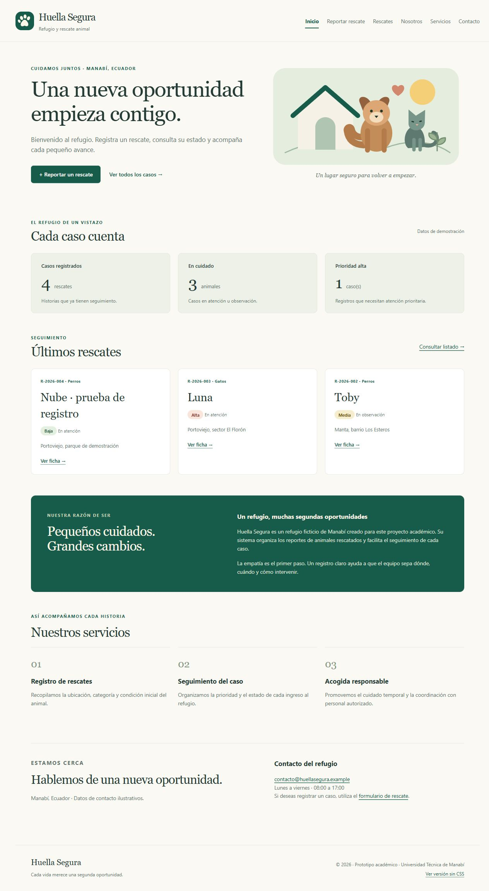
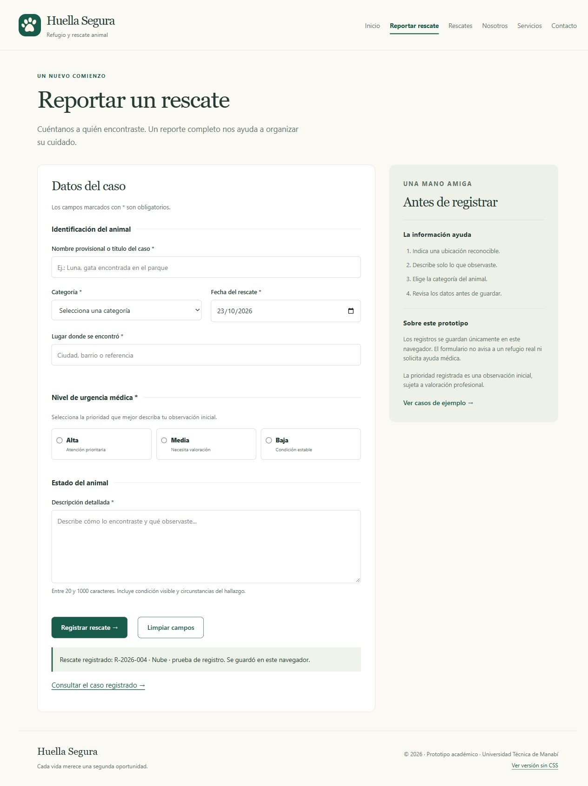
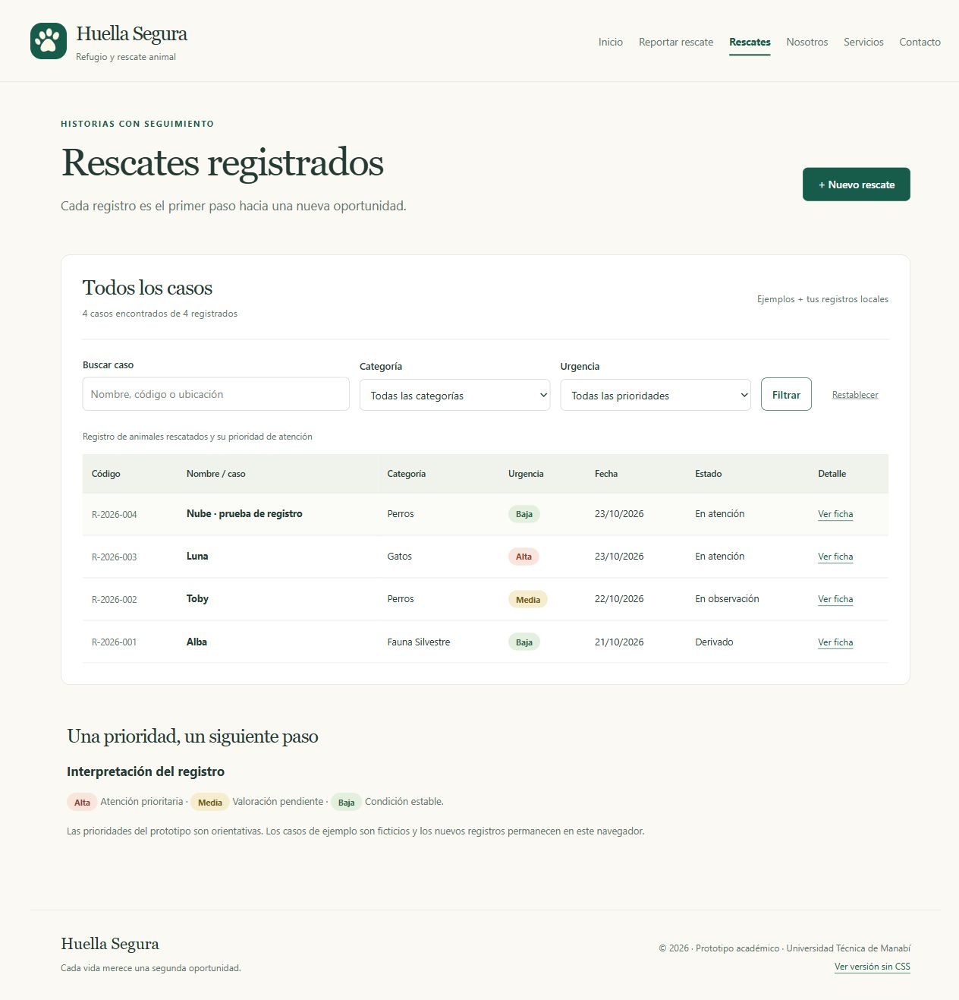

# Huella Segura · Sistema de rescate animal

Prototipo académico para Desarrollo de Sistemas Informáticos, Unidad 2, Universidad Técnica de Manabí. El refugio, las direcciones de contacto y los tres casos iniciales son ficticios. No se proporcionó un diseño de la Unidad 1; esta entrega propone una estructura original para el sistema de rescate.

## Dos versiones para resolver la consigna

- **Entrega principal, sin CSS:** index.html, reportar.html y rescates.html en la raíz. No contienen estilos en línea ni cargan hojas de estilo.
- **Complemento con CSS:** version-css/ contiene las mismas tres páginas con assets/css/estilos.css. Responde a la parte final de la consigna, que solicita colores, tipografía, distribución y evidencia de CSS.
- Ambas versiones comparten imágenes SVG locales y assets/js/rescate.js. El JavaScript hace funcional el prototipo; la estructura y los ejemplos también son visibles sin él.

## Abrir y probar

Puede abrirse index.html directamente. Para que las dos versiones compartan sus registros de forma consistente, se recomienda servir la carpeta por HTTP. Con Python instalado, desde esta carpeta:

    python -m http.server 8000

Abra http://localhost:8000/ para la entrega sin CSS y http://localhost:8000/version-css/ para el complemento visual. No requiere instalación de paquetes ni conexión a internet.

1. Abra Reportar rescate y complete todos los campos.
2. Seleccione una categoría y una urgencia, y escriba una descripción de 20 a 1000 caracteres.
3. Pulse Registrar rescate y siga el enlace de confirmación.
4. Compruebe el nuevo registro y abra su ficha.
5. Use búsqueda, filtros y Restablecer.
6. Vuelva a Inicio: el resumen y los últimos rescates reflejan el registro.

Los datos se guardan en localStorage de este navegador y origen; no se sincronizan entre dispositivos ni se envían a un refugio. Los filtros se actualizan al escribir o seleccionar. El formulario valida campos obligatorios, longitud y fecha no futura.

## Organización

    index.html
    reportar.html
    rescates.html
    assets/
      img/logo.svg
      img/refugio.svg
      js/rescate.js
      css/estilos.css
    version-css/
      index.html
      reportar.html
      rescates.html
    evidencias/
    README.md
    VALIDACION.md
    GITFLOW.md

## Requisitos cubiertos

- Navegación común con Inicio, Reportar rescate, Rescates, Nosotros, Servicios y Contacto.
- header, nav, main, section, article y footer según su función.
- Un h1 por página, idioma español, títulos únicos y enlaces para saltar al contenido.
- Formulario con label, fieldset, legend, input de texto, select, radio, textarea y botones nativos.
- Tabla con caption y encabezados scope; fichas en dialog accesible.
- Imágenes SVG propias con texto alternativo; sin recursos remotos ni fuentes externas.
- Versión CSS adaptable a móvil con foco de teclado visible y prioridades identificadas por texto y color.

Consulte VALIDACION.md para los resultados de validación y GITFLOW.md para la evidencia del flujo de ramas.

## Personalizar antes de entregar

Añada su nombre, paralelo y docente en la portada o en la plataforma según sus instrucciones. Los contactos con dominio .example son ilustrativos y deben reemplazarse si se adapta el proyecto a un refugio real.

## Capturas de la entrega

